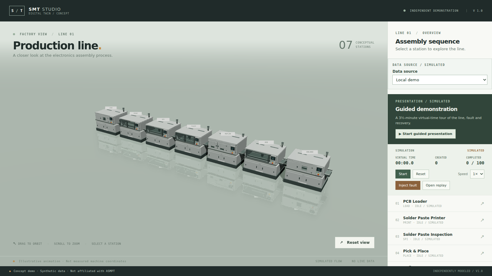
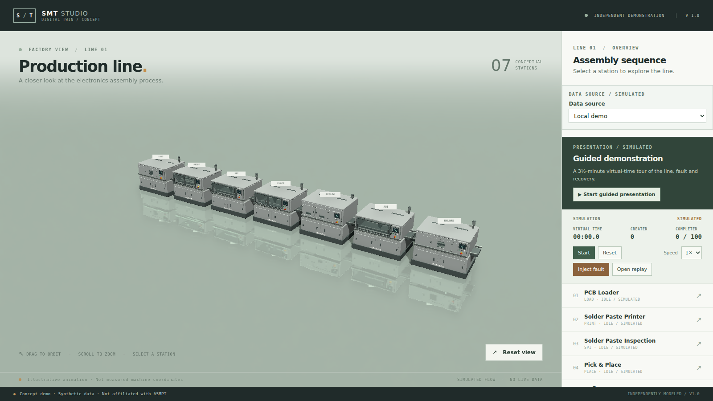

# Materials and ambient occlusion

Date: 2026-11-13. Branch: `v16-materials-ao`. **Awaiting user visual acceptance.**

## Delivered

- **Powder coat** changed from a bright, semi-metallic paint to matte paint: base colour `(.46, .49, .47)` (was `.68/.72/.69`), metallic `.04` (was `.27`), roughness `.62` (was `.48`). The metallic value on a non-metal surface was the main source of the plastic sheen. All seven GLBs were regenerated from the same geometry; only material factors changed.
- **Ambient occlusion** via the `n8ao` pass (`N8AOPass`), mounted through a three `EffectComposer` so the camera and scene come from R3F directly. Settings: half resolution, `aoRadius 0.6`, `distanceFalloff 0.8`, `intensity 1.5`.
- The pass is gated by `aoEnabled(search)` and skipped entirely with `?quality=low`, matching the existing lighting fallback. The query string is read at render time, not re-read on every frame.
- No geometry, camera, simulation, backend or copy changes. No downloaded textures.

## Inspect

```sh
npm run dev -- --host 127.0.0.1 --port 5188
```

| Before (old paint, no AO) | After (matte paint + AO) |
| --- | --- |
|  |  |

Close-ups: [mounter](screenshots/materials-ao/mounter.png) · [printer](screenshots/materials-ao/printer.png) · [reflow](screenshots/materials-ao/reflow.png). Low quality (no AO): [overview](screenshots/materials-ao/overview-low.png) · [mounter](screenshots/materials-ao/mounter-low.png).

Inspected at 1600×900 in headless Chromium/SwiftShader: contact shading now sits under every cabinet, inside door recesses and along panel seams; the glazed interiors stay readable rather than going black; the reflective floor shows no doubled or leaking AO; no console or page errors with the pass on or off.

## Measurements

| Item | Value |
| --- | --- |
| Bundle | 1,679 kB → 1,844 kB minified (478 → 564 kB gzip); existing >500 kB warning remains |
| New packages | `n8ao@2.0.2`, `@react-three/postprocessing@3.2.2` (brings `postprocessing@6.39.6`) |
| Overview callback rate, AO on | 2.53 /s |
| Overview callback rate, `?quality=low` | 5.29 /s |
| `npx vitest run tests/unit/{assets,ao}.test.ts` | passed |
| `npm test` | 83 passed, 1 skipped |
| `npm run typecheck` / `lint` / `build` | exit 0 |
| `npm run test:e2e` | 30 passed, 1 skipped, 6.3 min |

Both callback figures are headless SwiftShader at 1366×768, 5-second samples. They say the AO pass roughly doubles software-rasteriser cost; they say nothing about the demo machine, whose GPU previously ran the overview at 150–180 fps.

## Boundaries and decisions

- `@react-three/postprocessing` is installed but the pass is composed manually: its `EffectComposer` accepts `Effect`s, while N8AO ships a `Pass`. The manual composer is the integration N8AO documents, and it keeps R3F's camera and scene untouched.
- The composer renders with `useFrame` priority 1, so it owns the frame. Any future post effect must be added to that composer rather than mounted beside it.
- AO is not part of the `?quality=low` fallback by accident: it is the most expensive addition in this round on a software rasteriser.
- Material changes are independent of AO: reverting the generator commit restores the old paint without touching the pass, and `?quality=low` disables AO without touching the paint.
- No normal-offset or thickness tuning of the AO was needed; the glazing and the planar floor reflection showed no artifacts at these settings.
