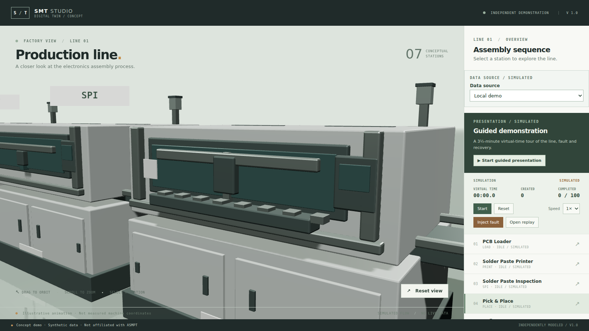
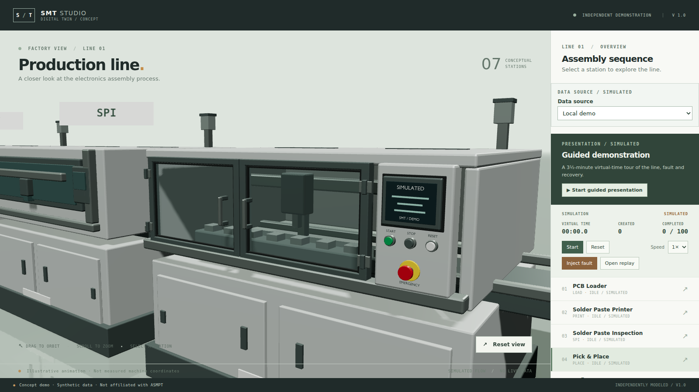

# Mounter vision-door sample

Date: 2026-11-12. Branch: `v13-mounter-vision-door`. **Awaiting user visual acceptance.**

## Delivered

- `assets/blender/generate_models.py`: mounter-only hollow enclosure, two closed framed doors with seals, hinges and raised handles; separate operator panel with layered HMI bezel, physical START/STOP/RESET buttons and mushroom emergency-stop/yellow collar.
- The HMI reads **SIMULATED** and **SMT / DEMO**. All geometry is original and generic. The panel is a static illustration, not an equipment control.
- `assets/blender/mounter.blend` and `public/models/mounter.glb`: updated sample. GLB **781,160 bytes**, **15 meshes / 36 primitives**. Limits remain <2 MiB and <=40 meshes.
- The upper enclosure is hollow; glass is alpha-blended (alpha 0.20), not an opaque block with mechanisms on top. Existing motion anchor names and offsets remain intact.
- Blended glazing no longer writes into the shadow map (`src/scene/assetMaterials.ts`): an opaque pane shadow would darken the cavity the sample exists to show. Opaque parts keep casting shadows.
- The two leaves are 8 mm apart with their own frames and seals, and the roof vents stand 7 mm proud of the new roof; the generator asserts both after building.
- Mechanism depth moved behind the pane; beam width reduced from 1.50 to 1.32 m and head/nozzle rest height adjusted to fit. Blender checks the moving bounding boxes at all offset extrema against side/back/roof/door/conveyor limits before export.
- Twelve hashes for the other six `.blend`/`.glb` pairs matched the baseline. No simulator, backend, camera, lighting or runtime changes.
- Asset tests cover detail assemblies and glazing; browser tests cover mounter selection and corrupt-GLB fallback.

## Inspect the sample

```sh
npm run dev -- --host 127.0.0.1 --port 5188
```

Open `http://localhost:5188/`, select **Pick & Place**, then **Start**. Orbit to inspect the door frames and operator panel. Add `?quality=low` for the existing lighting fallback.

| Previous close-up | Sample close-up |
| --- | --- |
|  |  |

[Overview](screenshots/mounter-sample/final-overview.png) · [Front/orbited view](screenshots/mounter-sample/final-oblique.png) · [Low-quality lighting](screenshots/mounter-sample/low-closeup.png) · [Running cycle](screenshots/mounter-sample/running-mounter.png)

Inspected at 1600×900 in headless Chromium/SwiftShader: door gaps, raised hardware, SIMULATED lettering and button profiles are readable in the existing focus camera. Running captures at virtual 13.0, 46.6 and 62.1 seconds show the mechanism inside the enclosure (the 38.8 s frame is committed); window mullions naturally obscure parts of the motion. Low-quality lighting makes the interior darker but the mechanism remains visible. No console/page errors in either capture run. These sampled images plus envelope assertions are not a full physical collision simulation.

## Reproduction and checks

From WSL, regenerate only this sample:

```sh
/mnt/e/blender-5.2.3-windows-x64/blender.exe -b --factory-startup \
  --python-exit-code 1 \
  --python "$(wslpath -w "$PWD/assets/blender/generate_models.py")" -- --kind mounter
```

The command exited 0 and printed `Mounter motion envelope: clear of enclosure at all extrema`. Blender 5.2.3 emitted a `Material.use_nodes` deprecation warning and factory brush relative-path warnings; GLB export completed. No-argument invocation retains the existing seven-kind export behavior; this sample run invoked only `--kind mounter`.

| Check | Actual result |
| --- | --- |
| Initial new asset test, before export | Failed on missing door node; seven existing asset tests passed |
| `npx vitest run tests/unit/assets.test.ts tests/unit/anchors.test.ts` | 14 passed |
| `npm test` | 69 passed, 1 skipped |
| `npm run typecheck` | Exit 0 |
| `npm run lint` | Exit 0 |
| `npm run build` | Exit 0; existing >500 kB bundle warning remains |
| `npm run test:e2e` | 24 passed, 1 skipped, 4.4 minutes |

The new browser coverage checks existing behavior, so it was not claimed as a failing-before/fixed-after bug test. No timeouts or test worker counts were changed.

### Performance diagnostic

Same host/browser/1600×900 viewport, paused mounter close-up, 5-second `requestAnimationFrame` callback sample after camera settling:

| Asset | Callback rate / second |
| --- | --- |
| Baseline v1.2 | 1.90 |
| Sample, default lighting (after review fixes) | 1.47 (earlier sample 1.80–1.82) |
| Sample, `?quality=low` (after review fixes) | 3.96 (earlier sample 4.80) |

These are short software-rasterizer callback measurements, not GPU frame timings or representative hardware acceptance. Run-to-run spread on this software rasteriser is large; the direction (sample at or below baseline) is consistent, but these numbers do not measure the target machine. The user's previously reported 150–180 fps is a separate observation; it does not establish refresh-rate capping or zero rendering cost.

## Boundaries and decisions

- Continue the established in-place feature-branch workflow; the current checkout displays the sample. The unrelated README badge and `docs/architecture.md` stay uncommitted.
- Beam/rest-pose adjustments preserve runtime travel but change conceptual mechanism proportions.
- Doors do not open, screen content is static, and the simplified mechanism is illustrative. No AO or new renderer dependencies. Other stations await sample acceptance.
- Review fixes: a fresh reviewer found the unresolved glazing shadow, overlapping door frames and coplanar vents. Each was fixed and re-inspected; the shadow fix is unit-tested, and the door-seam and vent checks fail the Blender export when the geometry regresses.
- Deferred after review: the clearance assertion's limits are looser than the modelled surfaces; `--kind` without `--` silently exports all kinds; the glazing material is pinned but not its primitive usage.
- Do not merge, push or roll out automatically: the next gate is the user's visual review.
