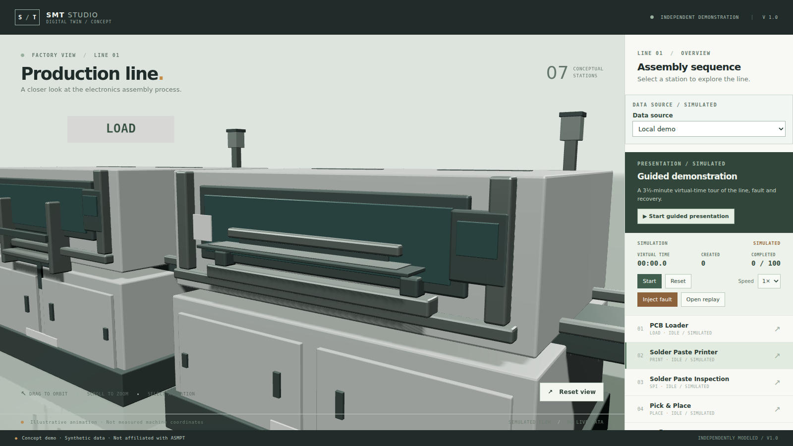
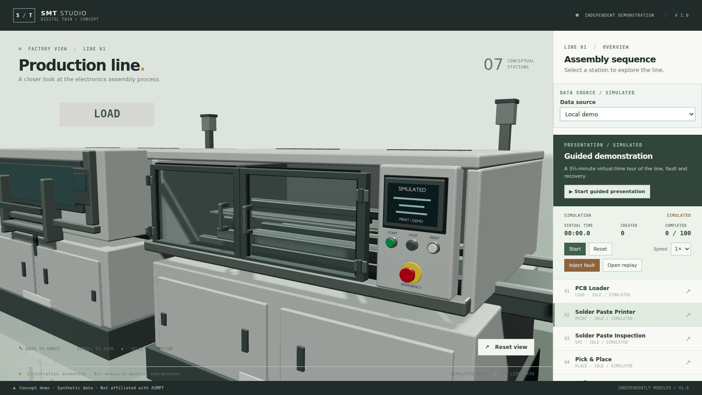

# Printer, SPI and AOI enclosure rollout

Date: 2026-11-13. Branch: `v14-printer-inspection`. **Awaiting user visual acceptance.**

## Delivered

Three of the four detailed stations now share the mounter sample's construction: a hollow upper enclosure, a framed and sealed observation door with hinges and a raised handle, and a separate side operator panel with a layered HMI, three physical buttons and a mushroom emergency stop.

- **Printer** — two doors, 0.90 × 0.62 m, showing the stencil and squeegee. The process was moved behind the panes at z 0.60, and the stencil frame, squeegee blade and board clamps switched from graphite to satin aluminium so the edge-on bars read as machined parts rather than shadow.
- **SPI / AOI** — one wide door, 1.80 × 0.62 m, with a shortened 1.16 m bridge so the ±0.57 m sweep clears the side walls. The camera body keeps its −0.05 m lift inside the glazing.
- Screens are labelled `PRINT / DEMO`, `SPI / DEMO`, `AOI / DEMO`, all carrying `SIMULATED`; status rows differ per station so the panels are distinguishable at close range.
- Glazing is `<kind> safety glass`, alpha 0.20, and never casts a shadow. The runtime policy now strips Blender's `.001` suffix, so a deduplicated material name cannot silently reintroduce an opaque pane shadow.
- Shared builders (`station_finish`, `vision_door`, `operator_panel`, `detailed_enclosure`) replace the mounter's private copies. The mounter itself is untouched: its `.blend`/`.glb` are byte-identical to `054f1c5`, and a fresh build was verified to produce the same 29 nodes, 15 meshes and 36 primitives before those regenerated bytes were discarded.

## Inspect

```sh
npm run dev -- --host 127.0.0.1 --port 5188
```

Open `http://localhost:5188/`, select a station and press **Start**. Add `?quality=low` for the existing lighting fallback.

| Printer before | Printer after |
| --- | --- |
|  |  |

[SPI](screenshots/printer-inspection/spi-closeup.png) · [AOI](screenshots/printer-inspection/aoi-closeup.png) · [Printer running](screenshots/printer-inspection/printer-running.png) · [SPI at low quality](screenshots/printer-inspection/spi-low-quality.png) · [AOI orbited](screenshots/printer-inspection/aoi-oblique.png) · [Overview](screenshots/printer-inspection/overview.png)

Inspected at 1600×900 in headless Chromium/SwiftShader: door frames, seals, hinges and handles read at the existing focus camera; the process is visible behind the glass on both the two-door and single-door layouts; running poses (squeegee travel, bridge sweep) stay inside the enclosure; no console or page errors in any capture session. Low quality darkens the interior but keeps the board and mechanism legible. Screenshots are evidence of appearance only, not of physical collision.

## Reproduction and checks

Regenerate one station at a time; a no-argument run still exports all seven:

```sh
for kind in printer spi aoi; do
  /mnt/e/blender-5.2.3-windows-x64/blender.exe -b --factory-startup \
    --python-exit-code 1 \
    --python "$(wslpath -w "$PWD/assets/blender/generate_models.py")" -- --kind "$kind"
done
```

Each run exits 0 after printing the motion-envelope, door-seam (two-door stations only) and roof-vent checks.

| Check | Actual result |
| --- | --- |
| `npx vitest run tests/unit/{assets,asset-materials,anchors}.test.ts` | 20 passed |
| `npm test` | 73 passed, 1 skipped |
| `npm run typecheck` | exit 0 |
| `npm run lint` | exit 0 |
| `npm run build` | exit 0; existing >500 kB chunk warning |
| `npm run test:e2e` | 26 passed, 1 skipped, 4.8 min |
| Protected artifacts | mounter, loader, reflow and unloader `.blend`/`.glb` hashes match the baseline |

Artifact sizes: printer 736,880 B / 15 meshes / 34 primitives; SPI 593,508 B / 11 / 29; AOI 590,820 B / 11 / 29. All are inside the 2 MiB and 40-mesh budgets with unique node names.

### Performance diagnostic

Same host, browser and 1600×900 viewport, paused close-up, 4-second `requestAnimationFrame` sample per station:

| Station | Before | After |
| --- | --- | --- |
| Printer | 2.41 | 1.89–2.35 |
| SPI | 2.67 | 2.13–2.49 |
| AOI | 2.48 | 2.18–2.72 |

These are software-rasteriser callback rates across a handful of runs, not GPU frame timings. The spread exceeds the difference, so this round shows no measurable rendering cost on this host; it says nothing about the demo machine.

### Test change

`w6-recovery.spec.ts` pushed its recovered snapshot on a 1.2 s timer, so the assertion for the first snapshot raced the replacement once the three heavier models made polling slower. The replacement is now pushed explicitly after that assertion, and the recovery assertions keep a 10 s budget. The covered behaviour is unchanged; only the race is removed.

## Boundaries and decisions

- Doors do not open, HMI content is static and labelled SIMULATED, and the mechanism motion remains illustrative.
- The printer ended up closer to the mounter's door height than the original "lower, broader" idea: a 0.50 m door left a dark band above the glass and hid the squeegee behind a narrow slot.
- The inspection stations get one door instead of two, and their bridge was shortened from 1.45 m to 1.16 m to keep the ±0.57 m travel inside the enclosure.
- No AO, post-processing, material overhaul, simulation, camera or backend changes. Reflow oven and the two loader stations still use the older shell and await their own round.
