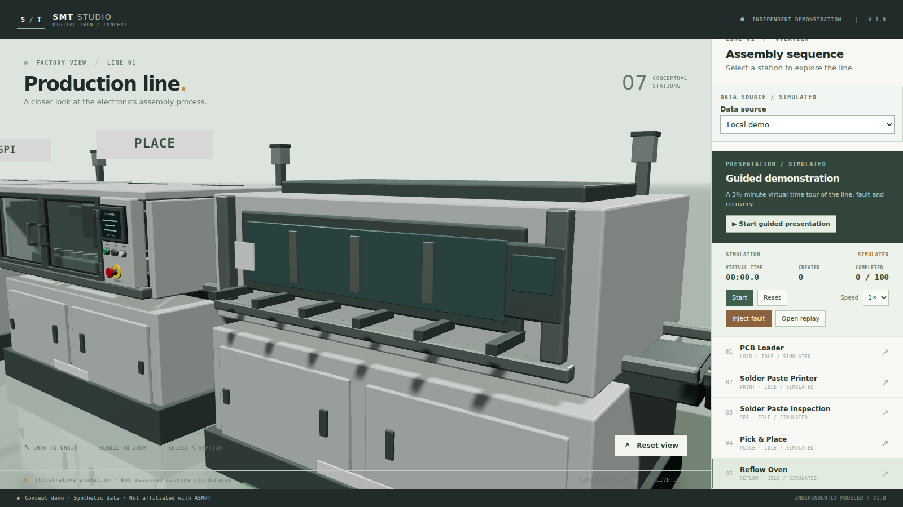
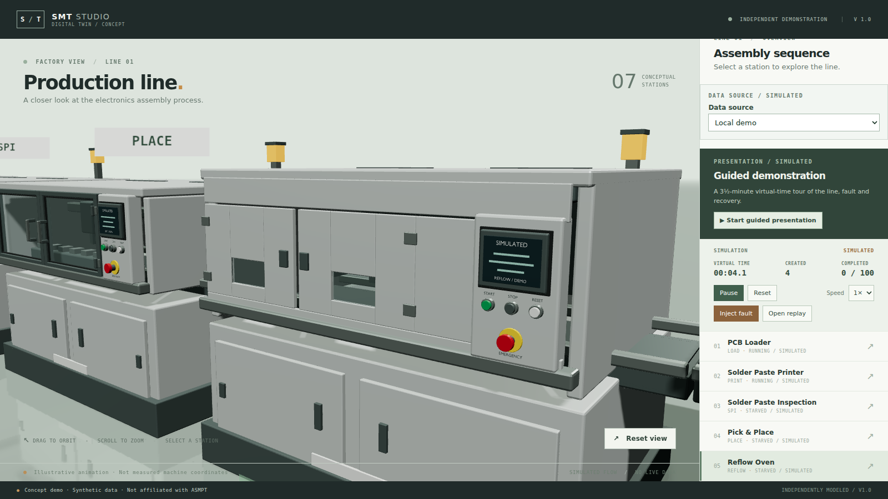

# Reflow and loader enclosures

Date: 2026-11-13. Branch: `v15-reflow-loaders`. **Awaiting user visual acceptance.**

## Delivered

The last three stations now share the other four's construction vocabulary, but not their window treatment: the oven is insulated cladding with small inspection apertures, the loaders are a clad guard door over the magazine.

- **Reflow oven** — two 0.78 × 0.58 m maintenance covers with 0.30 × 0.16 m heat-resistant windows, frames, hinges and latches, over a taller insulated shell. The tunnel's front wall was removed so the apertures look into the cavity (dark liner behind); belt cleats now run inside at z 0.02 and the zone shutters sit at z 0.60.
- **Loader / unloader** — one 1.05 × 0.52 m guard door with a 0.34 × 0.30 m window, plus a cladding header and infill closing the rest of the front up to the operator panel. Magazine, lift platform and pusher moved to z 0.48–0.62, behind the door.
- Panels: `REFLOW / DEMO`, `LOAD / DEMO`, `UNLOAD / DEMO`, all `SIMULATED`, with per-station status rows.
- Shared `service_cover()` builder; the four earlier stations are byte-identical and still build from the same helpers.

## Inspect

```sh
npm run dev -- --host 127.0.0.1 --port 5188
```

Select **Reflow Oven**, **PCB Loader** or **PCB Unloader**; add `?quality=low` for the lighting fallback.

| Reflow before | Reflow after |
| --- | --- |
|  |  |

Reflow: [running](screenshots/reflow-loader/reflow-running.png). Loaders: [before](screenshots/reflow-loader/before-loader.png) → [loader](screenshots/reflow-loader/loader.png), [unloader](screenshots/reflow-loader/unloader.png), [low quality](screenshots/reflow-loader/low-loader.png), [orbited](screenshots/reflow-loader/oblique.png).

Inspected at 1600×900 in headless Chromium/SwiftShader: the oven reads as insulated cladding with two small lit apertures rather than a glazed box; both loader doors show the magazine through their window with the header/infill closing the front; HMI labels legible; no console or page errors in any capture session.

## Reproduction and checks

```sh
for kind in reflow loader unloader; do
  /mnt/e/blender-5.2.3-windows-x64/blender.exe -b --factory-startup \
    --python-exit-code 1 \
    --python "$(wslpath -w "$PWD/assets/blender/generate_models.py")" -- --kind "$kind"
done
```

| Check | Actual result |
| --- | --- |
| `npx vitest run tests/unit/{assets,asset-materials,anchors}.test.ts` | 27 passed |
| `npm test` | 80 passed, 1 skipped |
| `npm run typecheck` / `lint` / `build` | exit 0 (existing >500 kB warning) |
| `npm run test:e2e` | 29 passed, 1 skipped, 5.7 min |
| Protected artifacts | mounter, printer, SPI, AOI hashes match `5b2c12d` |

Sizes: reflow 727,416 B / 14 meshes / 34 primitives; loader 598,376 B / 12 / 31; unloader 601,712 B / 12 / 31. All inside the 2 MiB and 40-mesh budgets with unique node names.

### Performance

Headless SwiftShader, 1366×768, paused close-up, 4-second `requestAnimationFrame` sample: reflow 2.09, loader 1.69, unloader 1.70 callbacks/s. No before sample was taken for these three this round, so no delta is claimed; these are software-rasteriser numbers, not GPU frame timings.

### Export guards

Each generation prints and enforces:

```text
reflow motion envelope: clear of enclosure at all extrema
reflow has no paired vision doors: no leaf seam to check
reflow roof vents stand 7.0 mm proud of the roof
```

The clearance table now carries optional per-station z travel and a floor bound: `Belt` ±0.36 m x, `Zone_Shutter` +0.03 m y, `Lift` +0.18 m y with a 0.70 m floor (the lift post passes through the cabinet), `Pusher` +0.10 m z.

## Boundaries and decisions

- Doors and covers stay closed; HMI content is static and labelled SIMULATED; mechanism motion remains illustrative.
- The oven's tunnel is now open at the front by design — the insulated covers are its front face; a retained wall would have shown a blank plate through both windows.
- Belt cleats dropped from six to five at the same 0.36 m pitch: six cleats plus the +0.36 m cycle offset reached 1.285 m, through the new side wall.
- No AO, post-processing, material overhaul, simulation, camera or backend changes.
- The branch is based on `v14-printer-inspection` (PR #11), not `main`, because it uses that round's shared builders.
