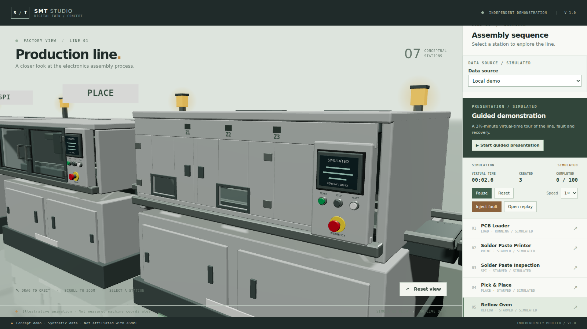
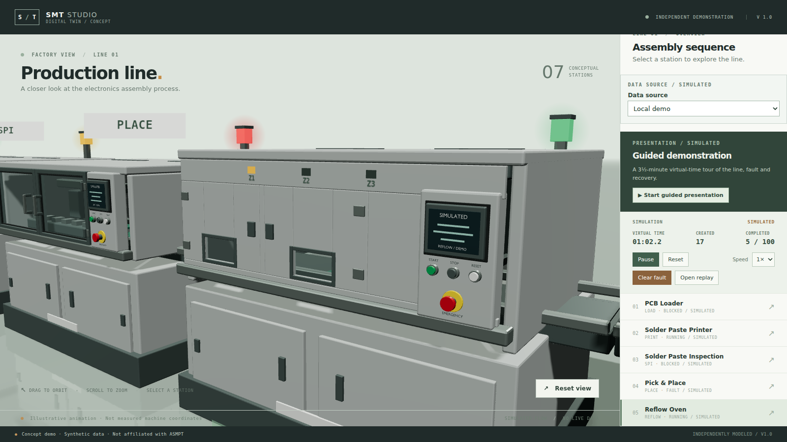
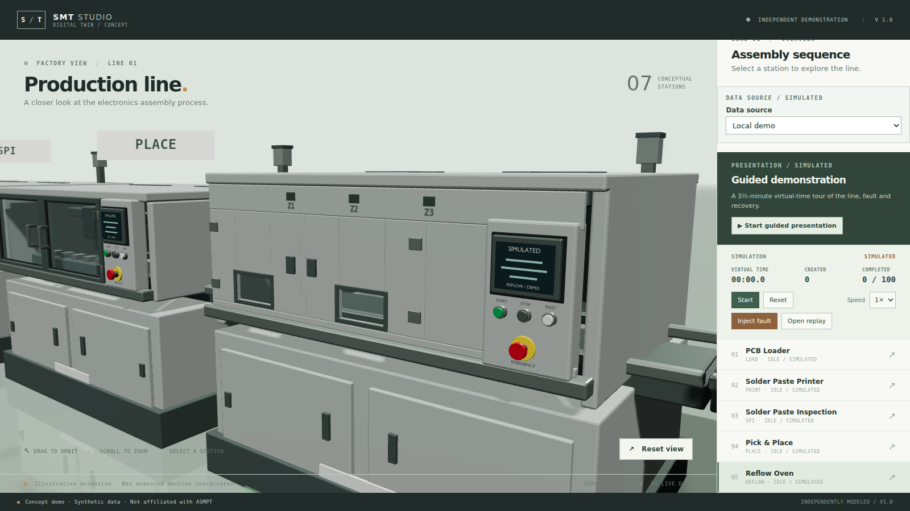

# Reflow zone indicators

Date: 2026-11-13. Branch: `v20-reflow-zones`. **Awaiting user visual acceptance.**

## What changed

The oven had three zone shutters and no way to read them. Three small lamps (Z1–Z3) and labels now sit on the insulated header, and the lamp for the zone holding the board is lit.

- Zone is derived from the existing process progress: `floor(progress × 3)`, clamped to 0–2, where progress is `(faultAtMs ?? simTime − startedAtMs) / processTimeMs`. No new state, no event change.
- Empty oven: all lamps dark. Faulted oven: the zone freezes at the moment of the fault, matching the mechanism. A finished board held behind a full downstream buffer stays on Z3.
- The three lamps sit at x −0.45, 0 and +0.45, which are the authored `Zone_Shutter` slat centres; a unit test asserts that against the GLB. The labels are runtime canvas textures and the lamps are scene geometry, so this round needed no asset regeneration.

## Evidence

| Zone 1 active | Zone 3 active | Fault | Idle |
| --- | --- | --- | --- |
|  |  |  |  |

The lamps and labels read at the existing mechanism camera. Dark ink keeps them legible on the pale cladding, and they are labelled `Z1`–`Z3` rather than given temperatures. The station-details footnote now says the lamps show illustrative staging, not a thermal profile.

Checks actually run:

```text
npx vitest run tests/unit/reflow-zones.test.ts   5 passed
npm test                                        128 passed, 1 skipped
```

## Boundaries and decisions

- This is process staging, not a thermal profile: there is no temperature, dwell time or recipe, and the labels deliberately avoid numbers.
- The zone follows the same `processTimeMs` the animation already uses, so it can never disagree with the mechanism.
- Labels are runtime canvas textures; nothing is downloaded.
- The row is placed with `ZONE_X`, asserted against the `Zone_Shutter` slats in the exported GLB; the vertical header position remains a literal because the header is a shared cladding box, not a named node.
