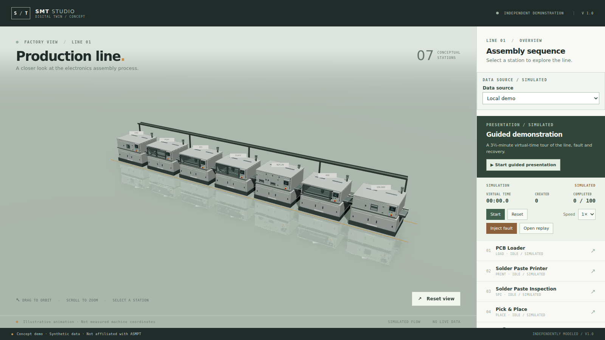
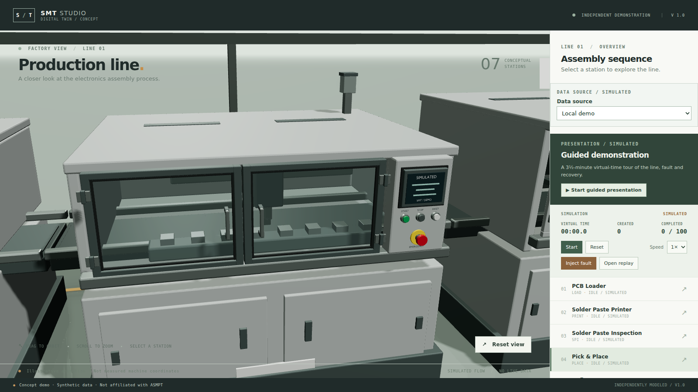

# Set-dressing pilot

Date: 2026-11-13. Branch: `v21-set-dressing`. **Pilot for visual acceptance — stop here if it does not earn its place.**

## What changed

Two cheap pieces of environment, both procedural and easy to remove:

- **Floor guides** — two painted lines at z ±1.15 m, just outside the machine footprints, running the length of the line. Muted amber, rough, no reflectivity of their own.
- **Cable tray** — one tray behind the machines at z −1.4 m and y 2.55 m, with five posts standing on the floor. Dark metal, casts shadows.

Ten extra meshes, no textures, no assets regenerated, no new dependency.

## Evidence

| Overview | Orbited close-up |
| --- | --- |
|  |  |

At the overview the guides give the line a footprint and the tray gives it a back edge, which is the scale cue that was missing. In close-up the tray reads as structure behind the machines rather than clutter in front of them.

Measured on headless SwiftShader at 1366×768, single 8-second sample each: **1.84 callbacks/s** before, **1.70** with the dressing. Ten meshes costing ~8 % on a software rasteriser is plausible; the difference is within about one frame of the sampling noise, so treat it as "small, not free".

## Boundaries and decisions

- This is the small pilot promised in `docs/FOLLOW_UPS.md`, not the full set-dressing pass. Ceiling trusses, fences, walkway markings, cabinets and floor paint are all still open.
- Everything is procedural in the scene (`src/scene/SetDressing.tsx`), so rejecting the pilot is one commit and touches no asset.
- Placement is data (`src/scene/setDressing.ts`) with unit tests: guides must clear the machine footprint, the tray must sit above and behind the machines, posts must stand on the floor.
- The tray deliberately runs behind the line: in front it would occlude the mechanisms the demo exists to show.

## Try it

```sh
npm run dev -- --host 127.0.0.1 --port 5188
```

Orbit to a low angle behind the line to see the tray, and reset to the overview to judge the guides. If either piece looks like clutter, say which and it goes.
