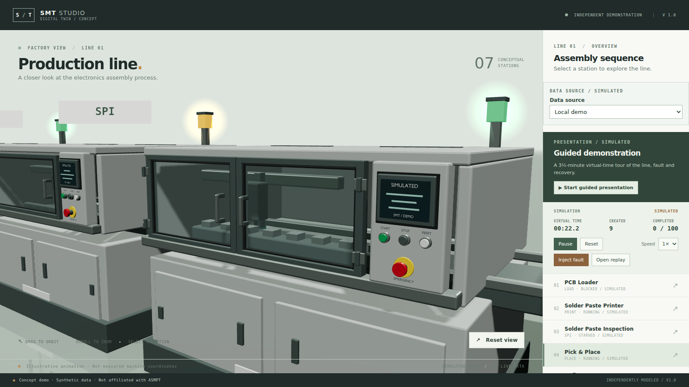
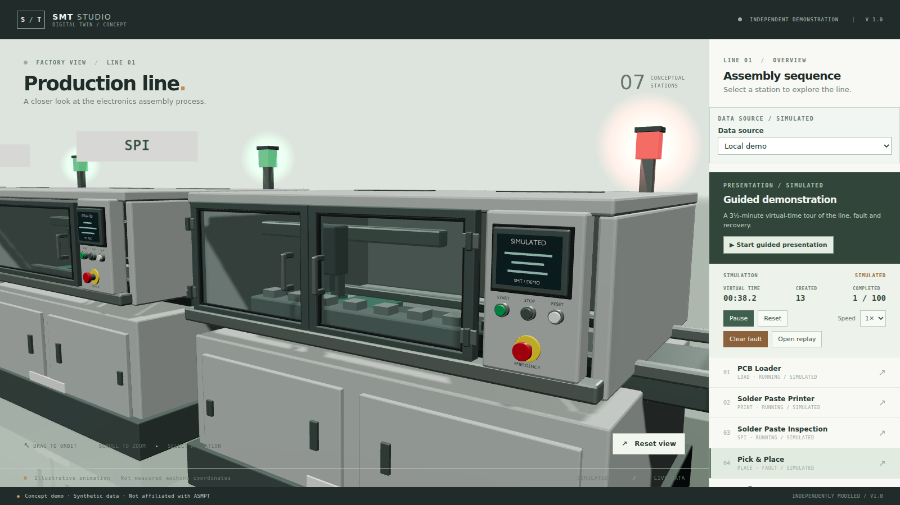

# Status light glow

Date: 2026-11-13. Branch: `v19-status-glow`. **Awaiting user visual acceptance.**

## What changed

The signal tower used to change colour only, which read as coloured plastic. Each station now gets a small additive halo over its lens, sized and brightened by state:

| State | Colour | Opacity | Halo width |
| --- | --- | --- | --- |
| FAULT | red | 0.68 | 0.64 m |
| BLOCKED / STARVED | amber | 0.58 | 0.56 m |
| RUNNING | green | 0.51 | 0.50 m |
| IDLE / other | grey | 0.24 | 0.29 m |

Implementation: `src/scene/StatusGlow.tsx` renders a `sprite` with a radial-gradient canvas texture generated at runtime, additive blending, `depthWrite` false and depth testing on, so a machine in front still occludes it. The mapping lives in `src/scene/statusGlow.ts` and is unit-tested.

Deliberately not a post-processing pass: a bloom pass would need render targets, tone-mapping care and its own quality switch — the same cost this project already rejected for ambient occlusion — to make three small lamps glow.

## Evidence

| Running | Fault injected |
| --- | --- |
|  |  |

The green halos read as lit lenses rather than painted cubes, and the faulted mounter's red halo is visible across the line without washing out the cabinets. Idle machines keep a faint grey halo so the tower does not look dead.

Checks actually run:

```text
npx vitest run tests/unit/status-glow.test.ts   2 passed
npm test                                        114 passed, 1 skipped
```

## Boundaries and decisions

- The halo is a sprite, not light: it does not illuminate the cabinet, cast shadows or change with camera exposure. It is a visual cue, consistent with the "illustrative" footer.
- Sizes stay under 0.7 m so a fault reads as a lamp, not a flare. The unit test pins the ordering (fault > running > idle) and the cap.
- Remote (W4) views get the same halo because they share the `status` prop.
- No dependencies, no new render pass, no change to the tower geometry or the material mapping.
