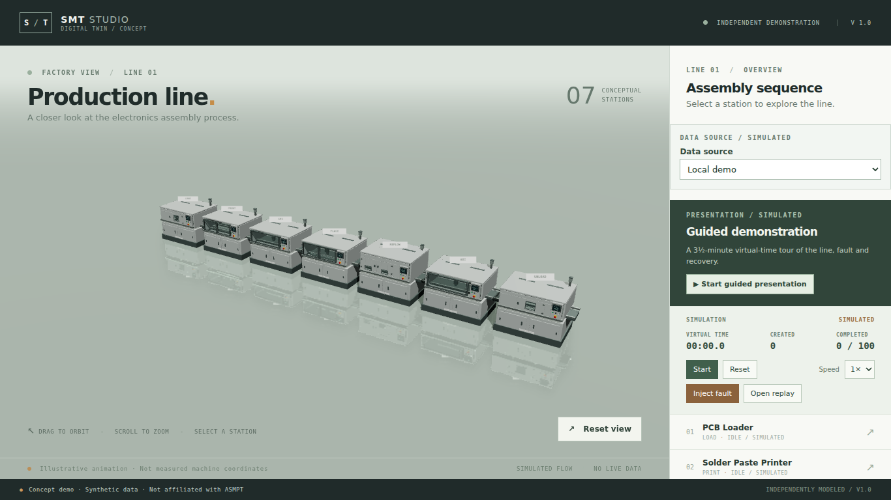

# Status light glow

Date: 2026-11-13. Branch: `v19-status-glow`. **Awaiting user visual acceptance.**

## What changed

The seven signal towers used to change colour only, which read as coloured plastic. Each station now draws a small soft halo over its lens, sized and tinted by state:

| State | Opacity | Halo width |
| --- | --- | --- |
| FAULT | 0.60 | 0.46 m |
| BLOCKED / STARVED | 0.52 | 0.42 m |
| RUNNING | 0.46 | 0.40 m |
| IDLE / UNKNOWN | 0.12 | 0.26 m |

Implementation: `src/scene/StatusGlow.tsx` renders a `sprite` with a radial-gradient canvas texture generated at runtime, normal blending, `depthWrite` false and depth testing on, so a machine in front still occludes it. The mapping lives in `src/scene/statusGlow.ts`; `SIGNAL_LENS` is the single authored lens position and is asserted against every GLB.

Why not additive, and why not bloom: an additive halo clips to white on this pale backdrop — the first version's "red" fault halo measured a white core and a cream fringe. Normal blending keeps the hue. A bloom pass would need render targets, tone-mapping handling and a quality switch for seven small lamps, which is the cost the ambient-occlusion round already declined.

## Evidence

| Overview, running | Fault injected, close-up | Idle |
| --- | --- | --- |
|  |  |  |

At the shipped overview camera the halos read as small lit lenses rather than flares. The faulted mounter's halo is red, not white, and stays local to the tower. Idle stations show no halo in practice: the 0.12 opacity on a pale wall is below one visible level, which is deliberate — an idle tower should look off.

Checks actually run:

```text
npx vitest run tests/unit/status-glow.test.ts tests/unit/assets.test.ts   42 passed
npm test                                                                 114 passed, 1 skipped
```

The unit tests pin the documented table for all five states plus `UNKNOWN`/`''`, the ordering (fault > starved > running > idle), and the width bounds (never narrower than the lens, never above the no-neon budget).

## Boundaries and decisions

- The halo is a sprite, not light: it casts no light or shadow, and it now participates in tone mapping like everything else.
- Widths stay at or under 0.5 m (lens is 0.12 m) so a fault reads as a lamp, not a flare.
- Remote (W4) views get the same halo because they share the `status` prop.
- One cached canvas texture for all seven sprites; it is intentionally never disposed, because disposing per unmount would blank the other stations.
- No dependencies, no render pass, no change to tower geometry or the colour mapping.
