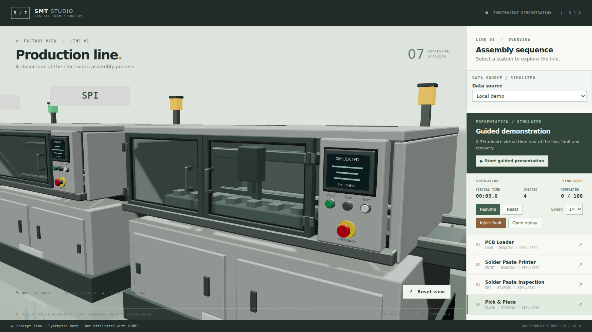

# Cross-station board transfers

Date: 2026-11-13. Branch: `v18-board-transfers`. **Awaiting user visual acceptance.**

## What changed

Boards no longer teleport between stations in the local demo. A pure module diffs successive scene snapshots and, when a board's station changes, animates it from where it was last drawn to its new slot over an illustrative 0.35–0.9 s of simulated time — stretched to at least two UI polls so faster speeds still show a frame in flight.

- **Duration**: `max(clamp(|Δx| × 110, 350, 900), 2 × poll gap)`. At 1× a station-to-station hop is 350 ms; at 5× the poll gap is 500 ms, so the hop is stretched to 1000 ms (200 ms of wall time) rather than being skipped.
- **Motion**: `easeInOutCubic` between the old station centre and the board's real target — its queue slot (`x − 1.2 + index × 0.5`) or its position on the conveyor as it processes.
- **Clock**: everything derives from `scene.simTimeMs`. Pausing freezes a board mid-hop; a backwards seek drops in-flight transfers and repositions boards; a new run starts with none.
- **Scope**: the simulator, event log and KPIs are untouched, and a board still transfers instantaneously in the model. Remote W4 boards keep their server-driven interpolation.

## Evidence



Paused at virtual `00:03.0` while `.scene[data-transfers]` was 1. A headless screenshot costs longer than a 350 ms hop, so three consecutive frames at 100 ms spacing cannot be captured from a live run; the still above is the frozen mid-hop frame instead.

The motion itself is pinned by a deterministic trace of the real engine, scene adapter and transfer module at 100 ms polls:

```text
3.0s  board-1 -> printer  x=-8.94  z=0.12
3.1s  board-1 -> printer  x=-8.74  z=0.12
3.2s  board-1 -> printer  x=-7.48  z=0.12
3.3s  board-1 -> printer  x=-6.81  z=0.12
```

Four samples, monotonic, no jump. An earlier version sampled three frames and moved the board 1.56 m in one of them; the hop now starts at the poll that discovers the move and is never shorter than two polls.

Most of a hop runs inside the machine enclosures, so on screen it reads as "enters the next machine" rather than crossing open floor.

Checks actually run:

```text
npx vitest run tests/unit/transfers.test.ts     12 passed
npm test                                        106 passed, 1 skipped
✓ boards travel between stations instead of teleporting   (Playwright, 14.9 s)
```

The pause case was measured by pixel difference: paused mid-run, two frames 900 ms apart differed by **0.00 levels** — the hop freezes with simulated time.

Frame cost, headless SwiftShader at 1366×768, running simulation, single 8-second sample each: **1.28 callbacks/s at `be62604`** vs **1.50 on this branch**. That is roughly 10–12 frames per sample, so the difference is not separable from noise; no cost and no gain is claimed, and no repeat runs were taken.

## Boundaries and decisions

- The transfer is a visual illustration, not a belt speed. Nothing in the UI claims otherwise, and the existing "illustrative animation" footer still applies.
- The path stays on the real conveyor line (`z 0.12`). Routing boards in front of the cabinets would make them easier to see and physically wrong, so it was rejected.
- A hop starts at the poll that discovers the move, which is up to one poll after the model transferred the board. The engine's transfer event is not exposed to the scene, and using the poll boundary keeps the module free of engine changes. The visible consequence is that the model can be up to one poll ahead of the picture; the hop itself always plays out over at least two polls, so 2× and 5× no longer skip it.
- A hop begins at the position where the board was last drawn, and z is interpolated too, so a board entering a queue does not jog backwards or snap sideways.
- Remote boards are unchanged; the server still supplies `visual.fromX/toX/startedAt`, and the transfer model ignores scenes that contain them.
