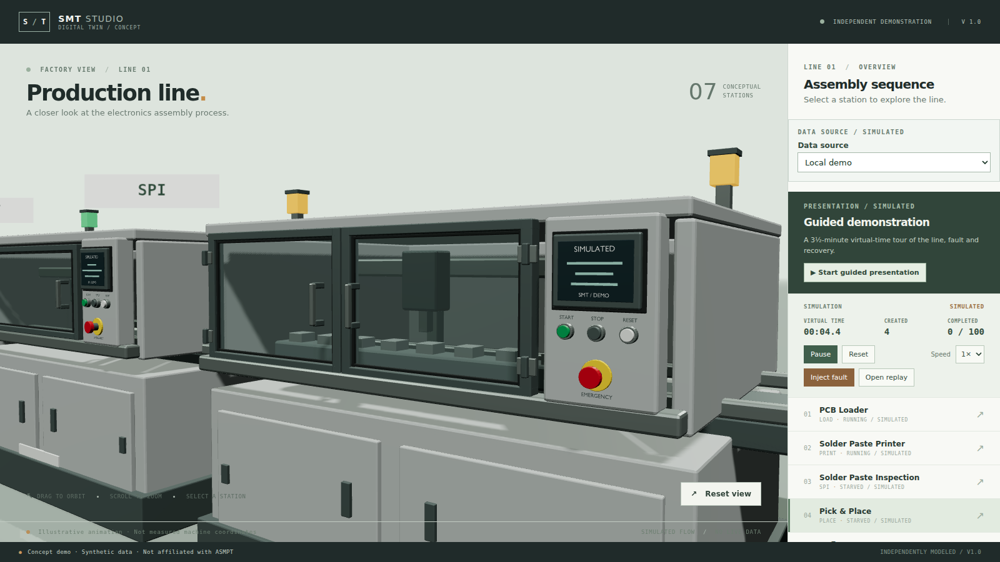
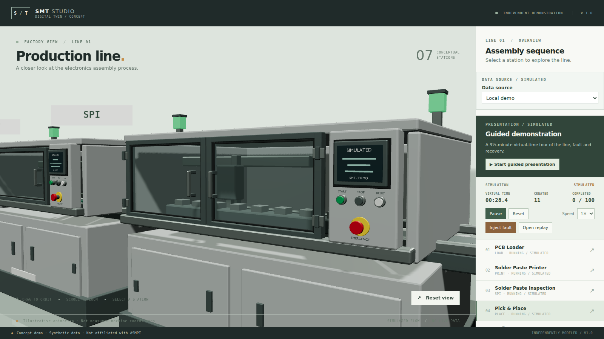
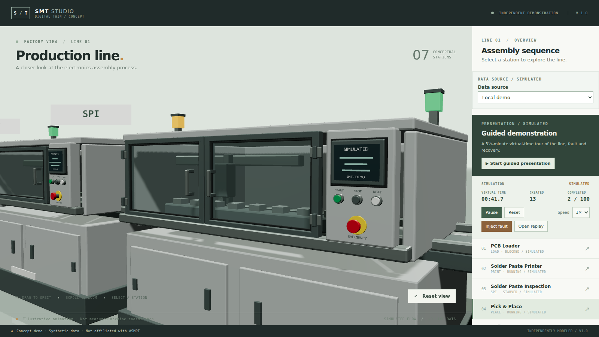

# Cross-station board transfers

Date: 2026-11-13. Branch: `v18-board-transfers`. **Awaiting user visual acceptance.**

## What changed

Boards no longer teleport between stations in the local demo. A pure module diffs successive scene snapshots and, when a board's station changes, animates its x from the old station to its new slot over an illustrative 0.35–0.9 s of simulated time.

- **Duration**: `clamp(|Δx| × 110, 350, 900)` ms. A neighbouring station hop is 350 ms; a long hop is 900 ms.
- **Motion**: `easeInOutCubic` between the old station centre and the board's real target — its queue slot (`x − 1.2 + index × 0.5`) or its position on the conveyor as it processes.
- **Clock**: everything derives from `scene.simTimeMs`. Pausing freezes a board mid-hop; a backwards seek drops in-flight transfers and repositions boards; a new run starts with none.
- **Scope**: the simulator, event log and KPIs are untouched, and a board still transfers instantaneously in the model. Remote W4 boards keep their server-driven interpolation.

## Evidence

| Mounter close-up, transfer in flight | Second poll | Third poll |
| --- | --- | --- |
|  |  |  |

The three frames are ~100 ms apart while `.scene[data-transfers]` was non-zero. Boards are visible on the conveyor through the glazing; most of a hop runs inside the machine enclosures, so the motion reads as "enters the next machine" rather than crossing open floor.

Checks actually run:

```text
npx vitest run tests/unit/transfers.test.ts     12 passed
npm test                                        106 passed, 1 skipped
✓ boards travel between stations instead of teleporting   (Playwright, 14.9 s)
```

The pause case was measured by pixel difference: paused mid-run, two frames 900 ms apart differed by **0.00 levels** — the hop freezes with simulated time.

Frame cost, headless SwiftShader at 1366×768, running simulation, 8-second samples: **1.28 callbacks/s at `be62604`** vs **1.50 on this branch**. Both are inside the run-to-run spread; no cost and no gain is claimed.

## Boundaries and decisions

- The transfer is a visual illustration, not a belt speed. Nothing in the UI claims otherwise, and the existing "illustrative animation" footer still applies.
- The path stays on the real conveyor line (`z 0.12`). Routing boards in front of the cabinets would make them easier to see and physically wrong, so it was rejected.
- A hop starts at the previous poll's simulated time, not at the exact event time. The engine's transfer event is not exposed to the scene, and using the poll boundary keeps the module free of engine changes. The cost is up to one poll (100 ms) of lag at 1×; at 5× the hop can begin and end between polls, in which case the board simply appears at its destination.
- Remote boards are unchanged; the server still supplies `visual.fromX/toX/startedAt`.
